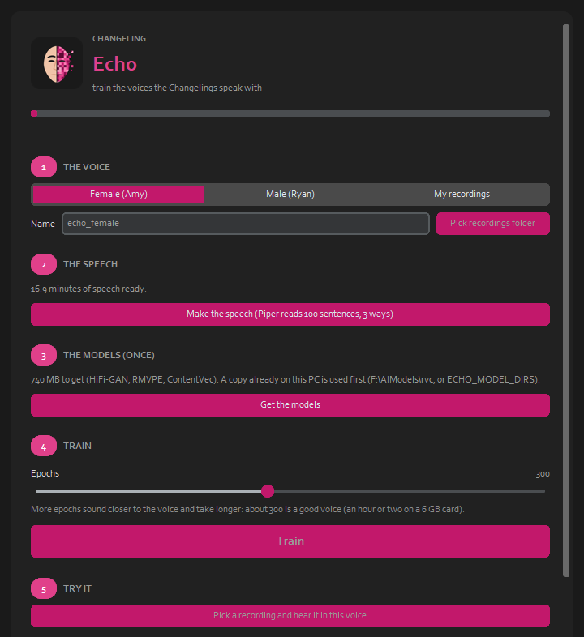

  

# Changeling Echo

**Website:** https://cursedprograms.github.io/Changeling-Echo/

*Part of the Changeling family, all together in [Changeling Studio](https://github.com/CursedPrograms/Changeling-Studio):
[CopyCat](https://github.com/CursedPrograms/Changeling-CopyCat) (face swap, photos and video) ·
[CopyCat Realtime](https://github.com/CursedPrograms/Changeling-CopyCat-Realtime) (face swap, live) ·
[Tiresias](https://github.com/CursedPrograms/Changeling-Tiresias) (gender) ·
[Chronos](https://github.com/CursedPrograms/Changeling-Chronos) (age) ·
[Natio](https://github.com/CursedPrograms/Changeling-Natio) (where in the world) ·
[Cosmetics](https://github.com/CursedPrograms/Changeling-Cosmetics) (makeup, hair, beards) · **Echo** (voices).*

Train the voices the Changelings speak with. Echo turns about 15 minutes of one person's speech into an
[RVC](https://github.com/RVC-Project/Retrieval-based-Voice-Conversion-WebUI) voice model; CopyCat Realtime and
Mosaic Mask then turn your voice into that one, live. The speech can be a built-in voice (Piper's Amy for a woman,
Ryan for a man, reading 100 sentences in three deliveries) or your own recordings.

Named after Echo, the nymph of Greek myth who was cursed to speak only in other people's voices.

## Use it

Start `run.bat` (or `.\run.ps1`, `./run.sh`). The first time it sets itself up: a Python 3.12 venv,
[Applio](https://github.com/IAHispano/Applio) (cloned; its training engine with PyTorch for CUDA, a few GB) and the
two Piper voices. An NVIDIA GPU is needed for training (6 GB is enough).

1. **The voice:** Female (Amy), Male (Ryan), or **My recordings** (a folder of WAVs: one speaker, no music, 10
   minutes or more). Give it a name (`echo_female` by default).
2. **The speech:** for a built-in voice, **Make the speech**: Piper reads the 100 sentences in `echo/corpus.txt`
   steady, quicker and livelier, and slower and calmer (about 15 minutes of speech, in under a minute).
3. **The models, once:** HiFi-GAN (generator and discriminator), RMVPE (pitch) and ContentVec (sound), about 740 MB:
   only what training at 40 kHz needs, not Applio's whole 2 GB set. A copy already on the PC is used first
   (`F:\AIModels\rvc`, or the folders in `ECHO_MODEL_DIRS`).
4. **Train:** slicing, reading pitch and sound, training (a completion bar with the epoch and the time left), indexing.
   About 300 epochs makes a good voice: an hour or two on a 6 GB card.
5. **Try it:** pick a recording and hear it in the new voice.
6. **Use it live:** CopyCat Realtime's **Echo** switch (and `--echo`) speaks female and male in `echo_female` and
   `echo_male`. It starts `echo/live.py` here, in Echo's own environment, and pipes the microphone through it a
   quarter second at a time: about 0.3 s behind you, under 100 ms of work per quarter second on a 6 GB card.

**Unattended:** `python echo/train_both.py 300` gets the models, makes the speech and trains both built-in voices
one after the other. Here that took about 100 minutes each on a 6 GB card. Measured on a test clip:
- the male reader through `echo_female` (+12 semitones) went from 158 to 301 Hz;
- the female reader through `echo_male` (-12) went from 195 to 97 Hz.

Both voices are also kept in `F:\AIModels
vcoices`.

## How it works

`echo/dataset.py` makes the speech with Piper (the same one DREAM speaks with; it loads the voice once).
`echo/train.py` runs Applio's own command line for each stage (preprocess, extract, train, index) and copies the
newest weights and index to `voices/`. `echo/models.py` fetches only the four model files training needs.

## Licenses

Echo is MIT; [Applio](https://github.com/IAHispano/Applio) is MIT; Piper's Amy and Ryan voices are from
[rhasspy/piper-voices](https://huggingface.co/rhasspy/piper-voices). Train voices only from speech you have the
right to use: your own, the built-in voices, or someone who agreed.

---

 

© Cursed Entertainment 2026

 

 

  

